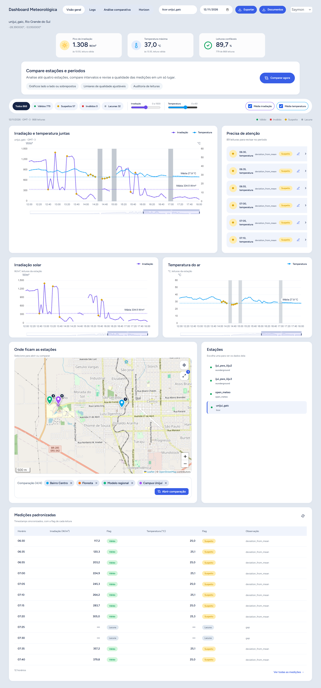
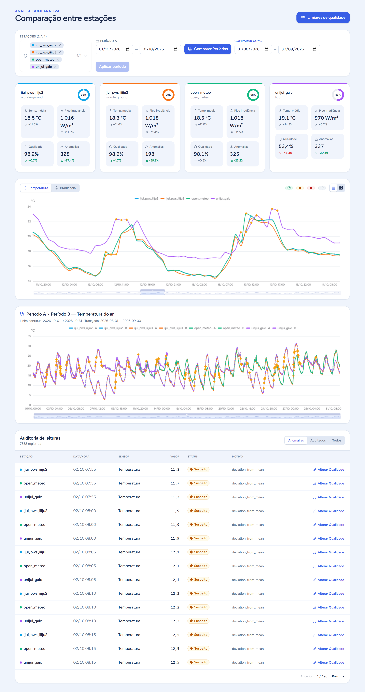
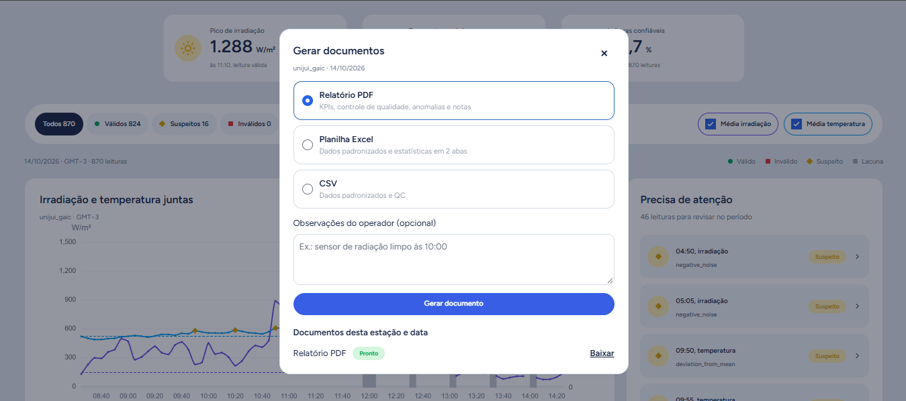
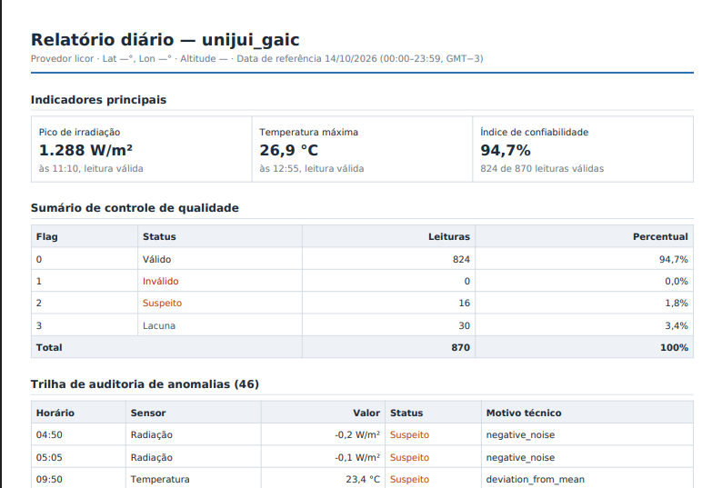
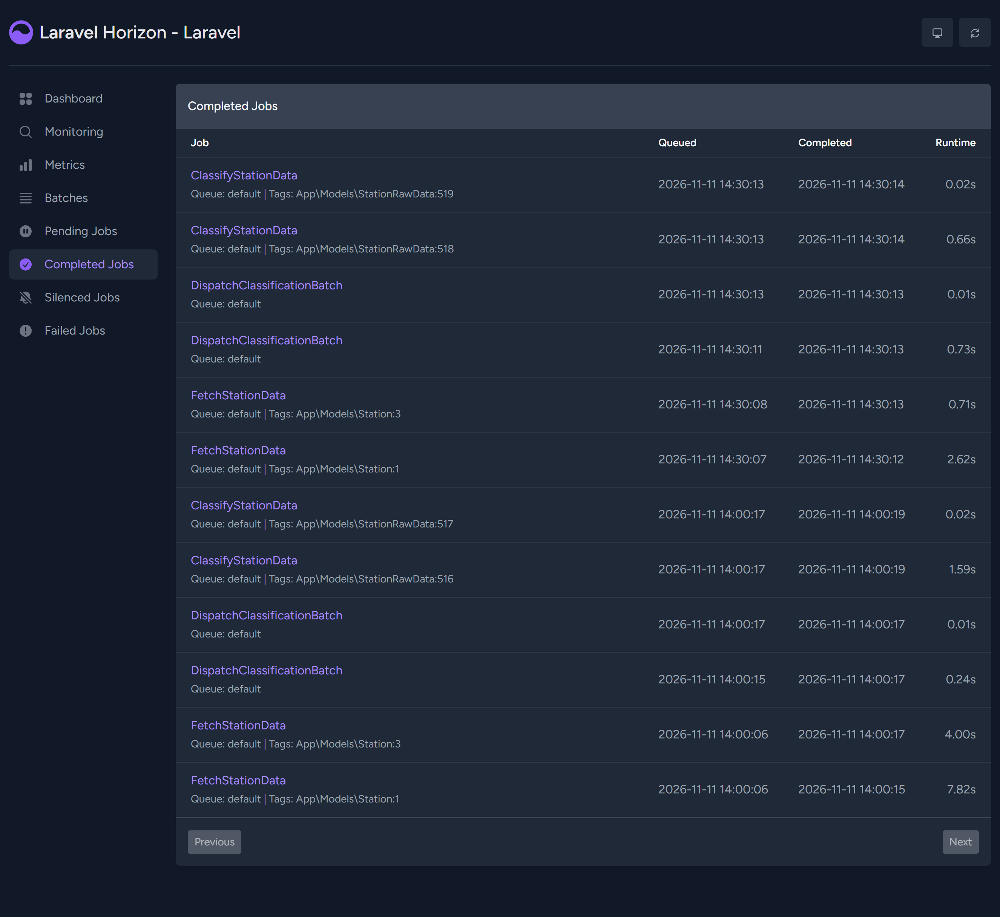

## Dashboard

Visão geral da estação selecionada, com indicadores de temperatura, irradiação, qualidade das leituras, gráficos e alertas para revisão.



### Comparação entre estações

Permite comparar até quatro estações e diferentes períodos, visualizar gráficos e resumos, ajustar limiares de qualidade e auditar leituras.



### Geração de documentos

Permite solicitar relatórios da estação em PDF, Excel ou CSV e acompanhar o status de geração.



### Relatório PDF

Apresenta o relatório diário com os dados meteorológicos, indicadores de qualidade e anotações do operador.



### Jobs concluídos no Horizon

Exibe o acompanhamento dos jobs processados pelas filas, incluindo os que foram concluídos com sucesso.



### Telas e Fluxograma no Figma
[Projeto no Figma](https://www.figma.com/design/lF5Fm3yNbVcWsoOaG9Ljbf/Untitled?node-id=1-2&t=fpFmr2RFByrE1oDz-1)

### Rodar o Projeto

Pré-requisitos: Docker com Docker Compose e Node.js/npm instalados. Execute os comandos a seguir na pasta raiz do projeto.

1. Crie o arquivo de ambiente:

   ```powershell
   Copy-Item .env.example .env
   ```

2. Configure o `.env` para os serviços do Docker. Use PostgreSQL e Redis; substitua a senha de exemplo por uma senha local segura:

   ```dotenv
   APP_URL=http://localhost:8000
   DB_CONNECTION=pgsql
   DB_HOST=db
   DB_PORT=5432
   DB_DATABASE=demei_dashboard
   DB_USERNAME=demei_user
   DB_PASSWORD=escolha-uma-senha-local
   REDIS_HOST=redis
   QUEUE_CONNECTION=redis
   ```

   Mantenha os demais valores de `.env.example` ou ajuste-os conforme o ambiente.

3. Instale as dependências PHP dentro do container:

   ```sh
   docker compose run --rm app composer install
   ```

4. Instale as dependências do frontend:

   ```sh
   npm install
   ```

5. Inicie a aplicação, o banco, o Redis, o Horizon e o scheduler:

   ```sh
   docker compose up -d --build
   ```

6. Gere a chave da aplicação, prepare o banco e cadastre as estações:

   ```sh
   docker compose exec app php artisan key:generate
   docker compose exec app php artisan migrate --force
   docker compose exec app php artisan db:seed --class=StationSeeder
   ```

7. Inicie o servidor de desenvolvimento do frontend em outro terminal:

   ```sh
   npm run dev
   ```

8. Acesse <http://localhost:8000>. O painel do Horizon fica disponível em <http://localhost:8000/horizon>.

Para compilar os arquivos frontend para produção, use `npm run build`. Para acompanhar os serviços, use `docker compose logs -f app horizon scheduler`.

#### Disparar a coleta manualmente

Com os serviços iniciados e as estações cadastradas, os jobs de coleta podem ser enviados à fila Redis:

```sh
docker compose exec app php artisan tinker
```

No Tinker, execute:

```php
App\Models\Station::where('is_active', true)->get()->each(
    fn ($station) => App\Jobs\FetchStationData::dispatch($station)
);
```

<p align="center"><a href="https://laravel.com" target="_blank"></a></p>

<p align="center">
<a href="https://github.com/laravel/framework/actions"></a>
<a href="https://packagist.org/packages/laravel/framework"></a>
<a href="https://packagist.org/packages/laravel/framework"></a>
<a href="https://packagist.org/packages/laravel/framework"></a>
</p>

## About Laravel

Laravel is a web application framework with expressive, elegant syntax. We believe development must be an enjoyable and creative experience to be truly fulfilling. Laravel takes the pain out of development by easing common tasks used in many web projects, such as:

- [Simple, fast routing engine](https://laravel.com/docs/routing).
- [Powerful dependency injection container](https://laravel.com/docs/container).
- Multiple back-ends for [session](https://laravel.com/docs/session) and [cache](https://laravel.com/docs/cache) storage.
- Expressive, intuitive [database ORM](https://laravel.com/docs/eloquent).
- Database agnostic [schema migrations](https://laravel.com/docs/migrations).
- [Robust background job processing](https://laravel.com/docs/queues).
- [Real-time event broadcasting](https://laravel.com/docs/broadcasting).

Laravel is accessible, powerful, and provides tools required for large, robust applications.

## Learning Laravel

Laravel has the most extensive and thorough [documentation](https://laravel.com/docs) and video tutorial library of all modern web application frameworks, making it a breeze to get started with the framework.

In addition, [Laracasts](https://laracasts.com) contains thousands of video tutorials on a range of topics including Laravel, modern PHP, unit testing, and JavaScript. Boost your skills by digging into our comprehensive video library.

You can also watch bite-sized lessons with real-world projects on [Laravel Learn](https://laravel.com/learn), where you will be guided through building a Laravel application from scratch while learning PHP fundamentals.

## Agentic Development

Laravel's predictable structure and conventions make it ideal for AI coding agents like Claude Code, Cursor, and GitHub Copilot. Install [Laravel Boost](https://laravel.com/docs/ai) to supercharge your AI workflow:

```bash
composer require laravel/boost --dev

php artisan boost:install
```

Boost provides your agent 15+ tools and skills that help agents build Laravel applications while following best practices.

## Contributing

Thank you for considering contributing to the Laravel framework! The contribution guide can be found in the [Laravel documentation](https://laravel.com/docs/contributions).

## Code of Conduct

In order to ensure that the Laravel community is welcoming to all, please review and abide by the [Code of Conduct](https://laravel.com/docs/contributions#code-of-conduct).

## Security Vulnerabilities

If you discover a security vulnerability within Laravel, please send an e-mail to Taylor Otwell via [taylor@laravel.com](mailto:taylor@laravel.com). All security vulnerabilities will be promptly addressed.

## License

The Laravel framework is open-sourced software licensed under the [MIT license](https://opensource.org/licenses/MIT).


docker compose exec app php artisan weather:backfill-open-meteo --all --dry-run

docker compose exec app php artisan weather:backfill-open-meteo --all

docker compose exec app php artisan weather:backfill-open-meteo --station=unijui_gaic